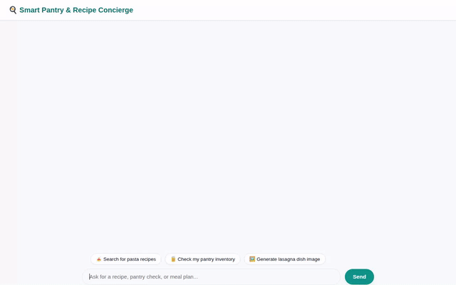

# Smart Pantry & Recipe Concierge

A conversational AI assistant built with the **Google Agent Development Kit (ADK)** that helps home cooks manage pantry inventory, search recipes, generate shopping lists, create AI dish photos and videos, find nearby grocery stores, and store user dietary preferences across sessions.



---

## Key Features & Capabilities

- **Long-Term Memory across Sessions**: Uses **Vertex AI Memory Bank Service** to automatically retain user dietary preferences, food allergies, and favorite cuisines across chat sessions.
- **Pantry Inventory Management**: Connects directly to **Google Cloud Firestore** to view, query (`get_pantry_inventory`), and add items (`add_pantry_item`) to your personal pantry.
- **Multi-Source Recipe Search**:
  - **Firestore Database Search** (`search_recipes`): Search internal saved recipe collections by dish name, cuisine, or ingredients.
  - **Live Online Search** (`search_online_recipes`): Query web recipe databases (TheMealDB API) for meal ideas, step-by-step instructions, and ingredient lists.
- **Automated Shopping List Generation** (`generate_shopping_list`): Compares required recipe ingredients against current pantry stock and automatically creates a list of missing items saved in Firestore.
- **AI Dish Photo Generation** (`generate_dish_image`): Uses **Vertex AI Imagen 3** (`gemini-3.1-flash-lite-image` in global region) to generate food imagery, saving images as ADK artifacts and publishing them to a public Google Cloud Storage bucket.
- **AI Dish Video Generation** (`generate_dish_video`): Uses **Vertex AI Omni** (`gemini-omni-flash-preview` in global region) to generate short dish presentation videos, saving video files as ADK artifacts and publishing to Google Cloud Storage.
- **Location & Store Discovery**:
  - **Geocoding** (`geocode_address`): Converts addresses into latitude and longitude coordinates.
  - **Nearby Grocery Search** (`find_nearby_places`): Uses **Google Places API** to find nearby supermarkets, grocery stores, and food markets within a given radius.
- **Secure Code Sandbox Calculations**: Runs Python code inside **Agent Engine Sandbox Code Executor** for ingredient scaling and nutritional math calculations.
- **Rich Interactive UI (A2UI)**: Formats model outputs into structured, responsive UI cards and image components rendered natively in the chat frontend.

---

## Project Architecture & Google Cloud Services

| Capability | Service / Framework | Implementation Details |
| :--- | :--- | :--- |
| **Agent Framework** | Google ADK Python SDK | `Agent` powered by `gemini-2.5-flash` model (`app/agent.py`) |
| **Long-Term Memory** | Vertex AI Memory Bank | `VertexAiMemoryBankService` & `PreloadMemoryTool` |
| **Database** | Google Cloud Firestore | Document collections for `recipes`, `pantry`, and `shopping_list` |
| **Media Storage** | Google Cloud Storage (GCS) | Direct memory-byte uploads serving public HTTPS URLs |
| **Image Generation** | Vertex AI Imagen 3 | `gemini-3.1-flash-lite-image` (Global Region) |
| **Video Generation** | Vertex AI Omni | `gemini-omni-flash-preview` (Global Region) |
| **Location Services** | Google Maps Platform | Geocoding API & Google Places API (New) |
| **Code Execution** | Agent Engine Sandbox | Python code executor for math & recipe scaling |
| **Rich UI Display** | A2UI (Agent-to-UI) | `A2uiSchemaManager` with `BasicCatalog` version 0.8 |

> **Project Brief Status**: All planned features from `project_brief.md` (Memory, Storage, Function Tools, Image Generation, Code Sandbox, A2UI) are fully implemented in code.

---

## Setup & Local Run Instructions

### Prerequisites
- Python 3.11+
- Node.js 18+ (for frontend)
- Google Cloud SDK (`gcloud`) with active GCP authentication
- Configured GCP Project with Firestore, Vertex AI, and Cloud Storage APIs enabled

### 1. Environment Setup

Copy `.env.example` to `.env` and configure your GCP environment variables:

```bash
cp .env.example .env
```

Ensure your `.env` contains:
```env
GOOGLE_CLOUD_PROJECT=your-gcp-project-id
GOOGLE_CLOUD_REGION=us-east1
GOOGLE_MAPS_API_KEY=your-google-maps-api-key
```

### 2. Install Dependencies

Install Python dependencies using `uv` or `pip`:

```bash
uv sync
```

### 3. Seed Initial Database Data

Populate Firestore with initial sample recipes and pantry items:

```bash
uv run python seed_firestore.py
```

### 4. Run the Backend & Frontend Proxy

Start the FastAPI proxy server locally:

```bash
AGENT_ENGINE_RESOURCE_NAME="projects/<project-id>/locations/<region>/reasoningEngines/<engine-id>" \
AGENT_DIRECTORY="app" \
PORT=8080 \
uv run python main.py
```

Open your browser to the local port specified by your development environment to interact with the application.

---

## Project Structure

```
my-simple-agent/
├── app/
│   ├── agent.py            # Main ADK agent definition & custom tools
│   ├── a2ui_utils.py       # A2UI callback and schema formatting utilities
│   └── fast_api_app.py     # FastAPI application endpoints
├── frontend/               # Custom web chat interface (HTML, CSS, JS)
├── seed_firestore.py       # Database seeding script for recipes and pantry
├── agents-cli-manifest.yaml # Deployment manifest configuration
├── Dockerfile              # Container definition for Cloud Run deployment
├── demo.gif                # Animated demonstration of the chat UI
└── pyproject.toml          # Python project dependencies
```
